**Ciência da Computação @ UNIVALI** · Santa Catarina, Brasil 🇧🇷

**AI & Automation Intern @ Conceito Imóveis**

---

## 🧭 Sobre mim

Sou estudante de Ciência da Computação na UNIVALI e estagiário na área de IA e automação. Meu foco é aprender a construir **sistemas de software que utilizam inteligência artificial para resolver problemas reais**, com atenção a arquitetura, testes, segurança e integração de sistemas.

Estou direcionando minha formação para **AI Engineering, agentes de IA e automações empresariais**, mantendo engenharia de software e bancos de dados como fundamentos técnicos.

## 🚀 Projeto principal — AI Dev World

[**Ver projeto no portfólio**](https://github.com/MoacirSimas-neto/AI-DEV-WORD/blob/main/docs/PORTFOLIO-SHOWCASE.md) · [Código e documentação](https://github.com/MoacirSimas-neto/AI-DEV-WORD) · [Versão 1.0.0 para Windows](https://github.com/MoacirSimas-neto/AI-DEV-WORD/releases/tag/v1.0.0)

**Uma central de desenvolvimento local com agentes de IA reais e um escritório 2D interativo.**

O projeto combina **React, TypeScript, Node.js, WebSocket, SQLite e Phaser** para explorar:

- **Orquestração multiagente:** planejamento, aprovação humana, desenvolvimento e revisão QA.
- **Integração com CLIs:** Codex, Gemini e Antigravity, com sessões de terminal.
- **Contexto e memória:** registro de decisões e recuperação de informações relevantes entre missões.
- **Interface em tempo real:** central de comando, monitoramento de tarefas e personagens em pixel art.
- **Fluxo de desenvolvimento:** histórico de execuções e acompanhamento Git.

> 🧪 **Status:** versão 1.0.0 publicada para Windows x64. A documentação de portfólio mostra o fluxo de uma missão, a arquitetura e as decisões de engenharia.

## 💼 Experiência profissional

### Conceito Imóveis — AI & Automation Intern

Desde novembro de 2026, em Florianópolis/SC, atuo em um estágio voltado ao apoio ao desenvolvimento de soluções com IA, automação de processos e integração de sistemas no setor imobiliário. Projetos internos e informações da empresa não são publicados neste perfil.

### Sistema interno de controle de estoque — Graal Solutions

Durante meu estágio em suporte de TI, participei da criação de uma ferramenta para facilitar um processo interno de vinculação e contagem de produtos.

**Minha contribuição:** modelagem do banco em PostgreSQL e definição das regras de negócio. O desenvolvimento contou com apoio de ferramentas de IA e colaboração com outro integrante da equipe, que realizou a integração no servidor.

O sistema foi implantado no ambiente interno da empresa. O código não é público por pertencer à empresa.

---

## 🧠 O que estou aprendendo e quero aprofundar

| Área | Aprofundando agora | Quero estudar mais |
| :--- | :--- | :--- |
| **🤖 AI Engineering** | Ferramentas de IA, Claude Code, orquestração de agentes e contexto | APIs de modelos, MCP, RAG, avaliação e segurança de agentes |
| **⚙️ Engenharia de software** | Node.js, TypeScript, React, SQL, Git e integração entre serviços | Arquitetura, testes, observabilidade e infraestrutura |
| **🔗 Automação** | Fluxos de trabalho e integração de sistemas | Automações confiáveis, aprovação humana e monitoramento |

**Minha direção:** construir soluções de IA aplicadas a problemas reais, com fundamentos sólidos de engenharia de software.

## 🎓 Formação complementar

| Curso concluído | Instituição | Data |
| :--- | :--- | :--- |
| Claude Code 101 | Anthropic | Novembro de 2026 |
| Claude Code in Action | Anthropic | Novembro de 2026 |

Atualmente sigo uma trilha de estudos em AI Engineering. Novas credenciais serão adicionadas conforme a conclusão dos cursos.

### Tecnologias com que já tive contato

Os ícones representam ferramentas que uso ou estudo, não domínio avançado de todas elas.

## 📁 Outros projetos e estudos

| Repositório | Aprendizado aplicado |
| :--- | :--- |
| **[Ventry](https://github.com/MoacirSimas-neto/VENTRY-REAL-V)** | Projeto pausado: modelagem MySQL, procedures, transações e frontend React com dados fictícios |
| **[PitGarage](https://github.com/AVRONT/pitgarage)** | Projeto colaborativo de aprendizado: análise de sistemas, regras de negócio e testes funcionais com apoio de IA |

## 🎯 Próximos objetivos

Aprofundar meus conhecimentos em **AI Engineering e engenharia de software**, concluir cursos oficiais, construir projetos demonstráveis e aplicar o aprendizado em soluções empresariais confiáveis.

Interesses profissionais: desenvolvimento de software, agentes de IA, automação e integração de sistemas.

### Vamos conversar?

